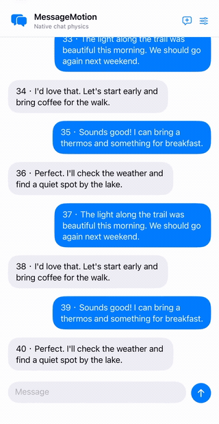
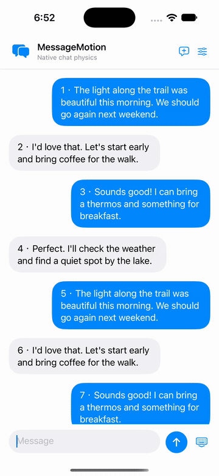

# MessageMotion

SwiftUI component for **Apple Messages / iMessage-style bubble scrolling**, using native UIKit springs. Includes touch interruption, minimum bubble spacing and keyboard-aware scrolling to the latest message.

| Item | Details |
|---|---|
| Use case | Add springy, bouncy message scrolling to an iOS chat |
| Scope | Bubble scrolling and keyboard coordination |
| Requirements | iOS 18+, Swift 6, Xcode 16+ |
| SwiftUI API | `MotionChat`, `.nativeKeyboardLayout()` |
| UIKit API | `MessageMotionLayout` (`UICollectionViewLayout`) |
| Dependencies | No third-party runtime dependencies |
| License | MIT |

[简体中文](README.zh-Hans.md) · [Implementation](docs/IMPLEMENTATION.md) · [Validation](docs/VALIDATION.md) · [Example source](Example/MessageMotionDemo/DemoChatView.swift)

## Demo

| Quick flicks and touch stops | Keyboard and return to latest |
|---|---|
|  |  |

Original-speed physical iPhone recording supplied by the project owner, showing the component example with local sample data. GIF previews loop at 50 fps. [Download the full silent recording (60 fps MP4)](https://raw.githubusercontent.com/Prinn-Liam/MessageMotion/main/docs/media/demo.mp4). The recordings predate the slow-drag refinement and current default tuning. These are not recordings of Apple Messages. [Capture details](docs/SHOWCASE.md#demo-provenance).

## Supported behavior

- Independent native spring per message bubble; spacing changes around the touch point during dragging and native deceleration.
- Touch a moving transcript to stop scrolling; remaining bubble offsets settle to rest.
- Configurable resting gap, minimum gap ratio, spring frequency, damping and drag strength.
- Focus the composer from history to scroll through intermediate messages to the latest message; coordinate the viewport and composer with the keyboard.
- Provide your own SwiftUI message views and composer, or integrate the UIKit layout directly.

This is a public-API approximation of the **scrolling animation**. It does not implement message-send effects, full-screen effects, reactions, the rest of the Messages interface, messaging transport or storage. The preset is fitted from observations; it is not Apple's internal implementation or measured Apple constants.

## Run the example

Open `Example/MessageMotionDemo.xcodeproj`, select **MessageMotionDemo** and run on an iPhone Simulator. XcodeGen is not required. For a physical iPhone, select your own signing team.

The example uses in-memory messages and includes motion settings with parameter descriptions and JSON export. Try slow dragging, flicking, touch-to-stop, focusing the composer from history and dismissing the keyboard. Launch flags: `--empty`, `--long-thread` (400 messages), `--reduce-motion`. The system Reduce Motion preference is also respected.

## Integrate

In Xcode, choose **Add Package Dependencies** and enter `https://github.com/Prinn-Liam/MessageMotion.git`; select the `main` branch. For a local checkout, use **Add Local Package**. Your messages need stable unique IDs, `Identifiable` and `Equatable`; IDs must also be `Sendable`.

Usage shape (supply your own message state, focus state and views):

```swift
import SwiftUI
import MessageMotion

MotionChat(messages: messages, isComposing: focused,
           isOutgoing: { $0.outgoing }) { message in
    YourBubble(message: message)
} composer: {
    YourComposer()
}
.nativeKeyboardLayout()
```

A complete runnable integration is in [DemoChatView.swift](Example/MessageMotionDemo/DemoChatView.swift).

- Let `.nativeKeyboardLayout()` own keyboard avoidance; do not add another keyboard-height padding or competing scroll-to-bottom animation.
- The component supplies the inter-bubble gap. Do not duplicate it inside each bubble view.
- Increment `layoutRevision` when geometry changes outside the message value, such as image loading or a style change.
- UIKit integrations must forward scroll/touch lifecycle events and stop native scrolling before forwarding touch interruption. See the [ownership rules](docs/IMPLEMENTATION.md).

## Implementation and defaults

`MessageMotionLayout` uses `UIDynamicAnimator` with one `UIAttachmentBehavior` per bubble. Continuous dynamic items retain subpixel positions; layout attributes are display copies. Nonzero attachment lengths avoid the near-anchor instability observed with zero-length springs. Scroll displacement perturbs springs using a capped distance-from-touch weight. Minimum visible spacing is enforced separately; animated frames determine visible cells. There is no extra speed multiplier or custom spring solver.

`keyboardLayoutGuide` controls keyboard geometry. A cancellable display link moves through actual intermediate rows toward the latest-message destination. Height-only viewport changes avoid collection-view layout transitions.

| Setting | Default |
|---|---:|
| `frequency` | 4.5 Hz |
| `damping` | 0.7 |
| `dragStrength` | 1.5 |
| `normalGap` | 16 pt |
| `minimumGapRatio` | 0.6 |
| `deformsDuringDeceleration` | true |

The initializer, `.messagesLike`, partial JSON decoding and example reset all use these defaults. To keep the earlier coefficients, explicitly set `damping: 1, dragStrength: 0.65`; the updated spring implementation still applies.

See [implementation details](docs/IMPLEMENTATION.md), [中文实现文档](docs/IMPLEMENTATION.zh-Hans.md), [measurement method](docs/MEASUREMENT.md) and [source code](Sources/MessageMotion/MessageMotionLayout.swift).

## Limits and verification

Physics state and layout queries are O(n) over loaded messages; add windowing before an unbounded history. Touch interruption rebuilds springs and clears velocities. Custom animated or interactive bubble content needs integration testing because appearing-cell cleanup removes initial layer animations. Test on your own target devices; there is no claim of pixel-perfect equivalence to Messages across devices.

```sh
swift test  # Core geometry/configuration tests on macOS.
# For UIKit coverage, run the example scheme's Test action on an iPhone Simulator.
python3 Tools/package_release.py --output /tmp/MessageMotion.zip
```

[Validation](docs/VALIDATION.md) distinguishes automated checks, interaction observations and remaining limits. [NOTICE](NOTICE.md) credits prior work, including [objc.io's collection-view dynamics article](https://www.objc.io/issues/5-ios7/collection-views-and-uidynamics/) and [BouncyLayout](https://github.com/roberthein/BouncyLayout). MessageMotion is independent of Apple.

## Support

If this component helps your project, a voluntary star helps others find it and gives maintainers a signal of interest. Bug reports and contributions also support continued open-source maintenance. See [CONTRIBUTING](CONTRIBUTING.md) and [LICENSE](LICENSE).
