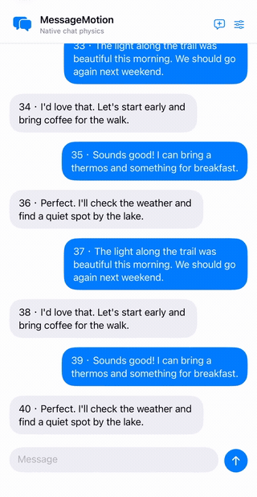
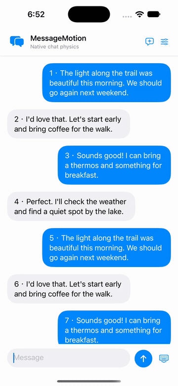

# MessageMotion

复刻 **Apple Messages / iMessage 气泡弹性滚动动画**的 SwiftUI 组件，使用 UIKit 原生弹簧，同时处理点住即停、最小气泡间距，以及键盘与滚动位置联动。

| 项目 | 说明 |
|---|---|
| 适用场景 | 为 iOS 聊天列表添加气泡弹性滚动 |
| 功能范围 | 气泡滚动动画、键盘联动 |
| 环境要求 | iOS 18+、Swift 6、Xcode 16+ |
| SwiftUI 入口 | `MotionChat`、`.nativeKeyboardLayout()` |
| UIKit 入口 | `MessageMotionLayout`（`UICollectionViewLayout`） |
| 依赖 | 无第三方运行时依赖 |
| 授权 | MIT |

[English](README.md) · [实现文档](docs/IMPLEMENTATION.zh-Hans.md) · [验证记录](docs/VALIDATION.md) · [示例源码](Example/MessageMotionDemo/DemoChatView.swift)

## 演示

| 快划、点住即停 | 键盘与回到最新消息 |
|---|---|
|  |  |

由项目拥有者在真实 iPhone 上录制，展示手机沙盒中承载的本组件示例，使用本地演示消息。前段为键盘开合与最新消息位置联动，后段为连续快划快停。GIF 按原速以 50 fps 循环播放；[下载完整静音录屏（60 fps MP4）](https://raw.githubusercontent.com/Prinn-Liam/MessageMotion/main/docs/media/demo.mp4)。素材录制于本次慢拖优化及默认参数更新之前，不是 Apple Messages 的录屏。[素材说明](docs/SHOWCASE.md#demo-provenance)。

## 已实现

- 每个气泡独立的原生弹簧；拖动、惯性滑动时，根据触点改变间距。
- 触摸正在滚动的页面立即打断滚动，剩余气泡偏移继续归位。
- 可调正常间距、最小间距比例、弹簧频率、阻尼、拖动强度。
- 浏览历史时点击输入框，经过中间消息回到最新位置；输入栏与视口随键盘开合调整。
- 调用方提供气泡样式、输入栏与消息数据，也可直接接入 UIKit 布局。

这是使用公开 API 对**滚动动画**的近似复现。不包含消息发送特效、全屏特效、表情回应、Messages 的其他界面、消息传输或存储。默认参数来自观察拟合，不是 Apple 的内部实现或实测内部参数。

## 运行示例

打开 `Example/MessageMotionDemo.xcodeproj`，选择 **MessageMotionDemo** 和 iPhone 模拟器运行。不需要 XcodeGen；装到真机时选择自己的签名团队。

示例使用内存消息，提供带说明的调参页和 JSON 导出。可以测试慢拖、快划、点住即停、从历史消息聚焦输入框和收起键盘。启动参数：`--empty`、`--long-thread`（400 条消息）、`--reduce-motion`；同时遵循系统“减弱动态效果”设置。

## 接入

在 Xcode 的 **Add Package Dependencies** 中输入 `https://github.com/Prinn-Liam/MessageMotion.git`，选择 `main` 分支；本地接入可通过 **Add Local Package** 选择目录。消息需遵守 `Identifiable`、`Equatable`，ID 稳定且唯一，并满足 `Sendable`。

以下为调用结构，消息状态、焦点和自定义视图由调用方提供：

```swift
import SwiftUI
import MessageMotion

MotionChat(messages: messages, isComposing: focused,
           isOutgoing: { $0.outgoing }) { message in
    YourBubble(message: message)
} composer: {
    YourComposer()
}
.nativeKeyboardLayout()
```

完整可运行代码见 [DemoChatView.swift](Example/MessageMotionDemo/DemoChatView.swift)。

- 让 `.nativeKeyboardLayout()` 负责键盘避让，避免重复添加键盘高度 padding 或竞争的滚到底部动画。
- 组件已经提供气泡间距，气泡视图内部不要重复添加。
- 图片加载、样式切换等消息值之外的几何变化，通过递增 `layoutRevision` 通知布局。
- UIKit 接入需转发滚动和触摸生命周期，并在转发触摸打断前先停止原生滚动。详见[实现文档](docs/IMPLEMENTATION.zh-Hans.md)。

## 原理与默认值

`MessageMotionLayout` 使用 `UIDynamicAnimator`，为每个气泡建立独立 `UIAttachmentBehavior`。连续物理对象保存亚像素位置，layout attributes 仅用于显示；非零长度 attachment 避免实测中零长度弹簧在锚点附近的不稳定。滚动位移根据到触点的距离权重作用于弹簧，另行约束最小可见间距，并根据动画后的 frame 判断可见单元。没有额外速度补偿或自定义弹簧求解器。

`keyboardLayoutGuide` 管理键盘几何；可取消的 display link 经过实际中间消息返回最新位置。仅视口高度变化时，避免触发 collection view 布局过渡。

| 参数 | 默认值 |
|---|---:|
| `frequency` | 4.5 Hz |
| `damping` | 0.7 |
| `dragStrength` | 1.5 |
| `normalGap` | 16 pt |
| `minimumGapRatio` | 0.6 |
| `deformsDuringDeceleration` | true |

初始化、`.messagesLike`、缺省 JSON 字段和示例重置均使用上述参数。需要保留旧系数时显式设置 `damping: 1, dragStrength: 0.65`；弹簧实现仍使用本次修复。

## 限制与验证

物理状态和布局查询随已加载消息数量呈 O(n) 增长，无限历史需要另做窗口化。触摸打断会重建弹簧并清零速度。带独立动画或交互的自定义气泡需要集成测试，因为新行入场会清理首次布局动画。请在自己的目标设备上测试；不声称与 Messages 在所有设备上像素级一致。

`swift test` 可在 macOS 运行核心几何与配置测试；UIKit 覆盖通过示例工程在 iPhone 模拟器运行 Test。`python3 Tools/package_release.py --output /tmp/MessageMotion.zip` 导出独立源码包。

[验证记录](docs/VALIDATION.md) 区分自动检查、交互观察与限制；[测量方法](docs/MEASUREMENT.md) 和 [NOTICE](NOTICE.md) 记录方法与来源，包括 objc.io 和 BouncyLayout 的相关工作。本项目与 Apple 无隶属关系。

## 支持

如果组件对你的项目有帮助，欢迎自愿 Star，让同样寻找这个效果的人发现它，也让维护者知道有人需要它。问题反馈和代码贡献同样有助于开源项目持续维护。见 [CONTRIBUTING](CONTRIBUTING.md) 和 [LICENSE](LICENSE)。
